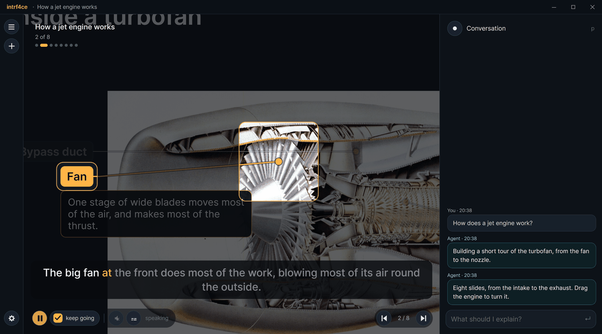
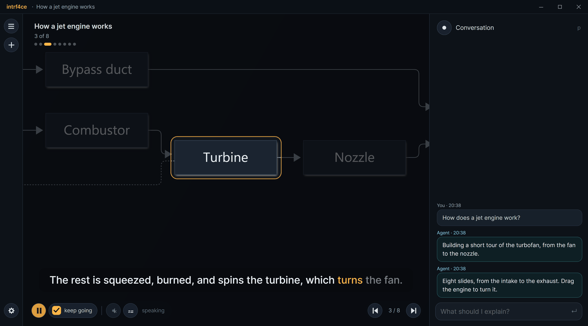
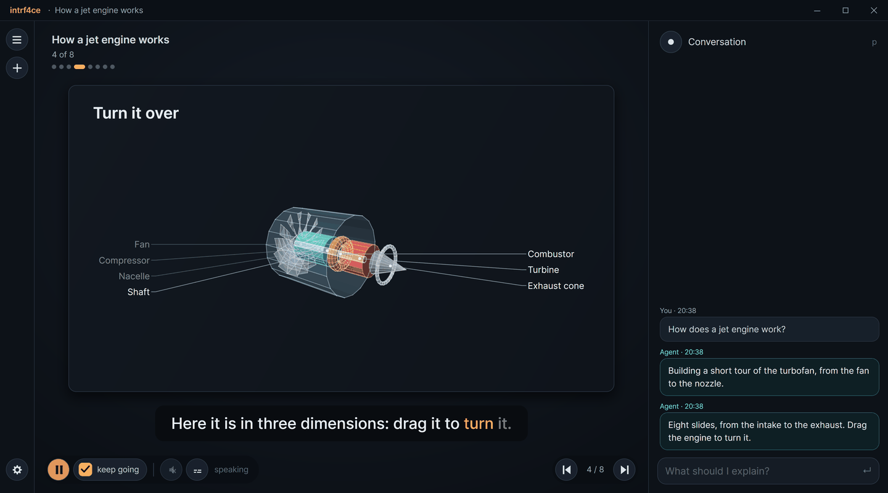
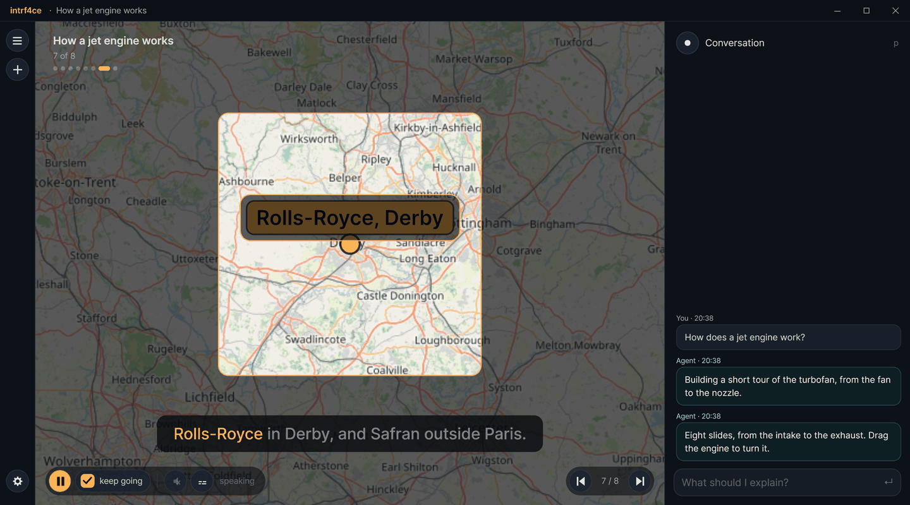

# intrf4ce

A presentation that builds itself while you watch.


intrf4ce is a stage an agent drives over MCP. You ask for something to be explained — a concept,
a machine, a folder of photos, a book — and slides appear one after another: images with labelled
callouts, diagrams that zoom node by node, formulas, charts, tables, photo galleries and quizzes,
narrated aloud with subtitles, the camera flying to whatever the narration is talking about.

The agent says *what*; intrf4ce decides *how*. Fonts, colours, motion, voice and pacing are yours,
in `settings.yaml`, and no tool lets an agent touch them.

## Quick start

Download `intrf4ce-win-x64.exe` from the [latest release](../../releases/latest), or build it
(see [Building](#building)), and run it. It is one self-contained file: no .NET to install. It
needs Windows 10 or 11 with the WebView2 runtime (Windows 11 has it), and an agent to run — Claude
Code or OpenAI's Codex, installed and signed in.

By default intrf4ce runs **Claude Code for you**: start the app, type what you want explained in
the box on the right, and watch. It needs `claude` on your PATH; anything else is settings.

It can run **OpenAI's Codex** instead, on your ChatGPT account: choose *codex* for *Agent* in the
settings panel (`,`), or set `agent.provider: codex` in `settings.yaml`, and start intrf4ce again.
That needs `codex` on your PATH (`npm install -g @openai/codex`).

To drive it from an agent you run yourself, set `agent.mode: attached` in `settings.yaml` and
register intrf4ce as an MCP server:

```bash
claude mcp add intrf4ce -- "C:\path\to\intrf4ce.exe" --mcp
```

or, for Codex, `codex mcp add intrf4ce -- "C:\path\to\intrf4ce.exe" --mcp`.

`intrf4ce --mcp` is the same executable in shim mode: it pumps JSON-RPC between your agent and the
running window, and starts the window if it is not open yet.

## What the agent can put on a slide

<p>
  
  
  
  
</p>

*How a jet engine works*, as built in the recording above. The agent's side of it was scripted
over the same MCP tools an agent uses, so it is quicker than a real one, which researches as it
goes. Cutaway: GE CF6-6, U.S. National Archives, public domain. Map data © OpenStreetMap
contributors.

| element | what it is |
|---|---|
| `title` | a title slide: kicker, title, subtitle |
| `markdown` | CommonMark with tables, code and `$…$` / `$$…$$` TeX |
| `image` | a file or URL, with callouts laid out in gutters beside it, anatomy-atlas style |
| `diagram` | Mermaid; node ids become focus targets, `steps` lets you walk them |
| `math` | TeX, rendered large |
| `chart` | bar, line, area, pie, donut, scatter — or a full Vega-Lite spec |
| `table` | numbers aligned and grouped, headings that sort, rows you can focus |
| `gallery` | a folder of photos or a list of items: a scattered pile, a grid, or a timeline by date taken |
| `quiz` | single or multiple choice; the answer goes back to the agent |
| `map` | OpenStreetMap, with the places the narration visits marked and joined; focusing a place flies the map to it |
| `model3d` | an object in 3D — built from boxes, spheres, cylinders, capsules, cones, tori, lines and meshes, or loaded from an `.obj` or `.stl` — as wires, shaded faces or both, its parts labelled; focusing a part turns the model to face it, it can spin and pull its parts apart, and you turn it by dragging it or with J and K |

And whatever plugins add. Three come built in, and keep their data current while the slide is up:

| element | what it is |
|---|---|
| `timezones` | a 24-hour timeline across places, each hour shaded asleep, early, working or evening, with each place's clock, a line at now, and when its clocks change |
| `weather` | the weather anywhere, from Open-Meteo: now, a strip of days, the 72-hour temperature and rain trend, the UV peak, sunrise and sunset |
| `holidays` | the next public holidays in a country, from Nager.Date, with the regions each applies in and how soon; your region's in full colour |

Narration carries cues that fire as the voice reaches them: `[[focus knee.acl]]` zooms to a callout
and dims the rest, `[[zoom map 0.2 0.3 0.4 0.3]]` frames a region, `[[show chart]]` reveals a hidden
element, `[[clear]]` returns to the whole slide.

## Keys

Keyboard first, as in Fjord: every action is a command you can type after `:`, and every key runs
one. The keys are vim's where vim has one.

| | |
|---|---|
| `h` `l` (or `←` `→`) | previous, next slide — `3l` is three on |
| `j` `k` (or `↓` `↑`) | the next, previous part of a slide (callouts, diagram steps, rows, places) |
| `gg` `G` | first, last slide; `:12` goes to slide 12 |
| `o` `0` | overview of the whole deck; back to the whole slide |
| `Space` | play or pause this slide; a pause holds: going to another slide leaves it quiet until you play |
| `c` | keep going through the deck, or stop at the end of each slide |
| `x` | stop: no voice, and nothing moves on by itself |
| `m` `s` | mute (nothing is sent to the voice), subtitles |
| `gv` | say this slide again in the current voice (`:revoice all` for every slide) |
| `q` `p` | fold or open the sessions column, the conversation column |
| `` ` `` or `Enter` | talk to the agent — in the conversation, or at the foot of the stage when that is folded |
| `:` | the command line: Tab completes names and arguments, ↑ walks the history |
| `?` | every command and the keys it is on |
| `n` | a new session: an empty stage and a fresh conversation |
| `dd` `u` | delete this session, everything in it; bring it back (until intrf4ce closes) |
| `,` | settings |
| `i` | the picture on this slide, filling the stage |
| `+` `-` | zoom in, out |
| `f` `F11` | fullscreen |
| `z` | just the slides: hide the title, the progress and the buttons over the stage, or bring them back |
| `J` `K` `r` | move the cursor inside the element in focus — an hour on or back in time zones or a forecast, a turn of a 3D model; `3J` is three; `r` puts it back |
| `Esc` | back out of whatever is open; stops the agent mid-answer |

Some commands with no key of their own: `:set subtitles!` flips a setting, `:set volume 0.5` sets
one, `:config` opens settings.yaml in your editor, `:group Rivers` files this session, `:rename …`,
`:open <session>`, `:delete <session>`, `:ask …`, `:attach <path>`, `:login` signs the agent in to
your Claude account, `:plugins`, `:plugin install <file>`, `:bind gt next` and `:unbind x` (both
kept in settings.yaml), `:q` to quit. Plugins add their own: `:weather Zagreb`, `:time Melbourne
and Zagreb`, `:holidays` ask the agent for a slide of each. In any text box, Enter sends and
Shift+Enter is a new line.

With the mouse: the wheel zooms, dragging pans, and clicking a callout, a node, a photo, a row or
a place on a map focuses it (and again goes back). Right-clicking anything offers **Ask about
this**, which frames the thing on the stage and sends your question to the agent along with what
you pointed at. Dragging a 3D model turns it rather than the stage. Double-clicking a picture gives it the whole stage; in there, dragging a box over
any part of it and right-clicking asks about that area, and the agent is told where the box was in
the picture's own coordinates. Double-clicking anywhere else puts the slide back as it was.

The controls along the bottom are the performance on the left — play or pause this slide, a tick
for whether it runs on through the rest of the deck, the voice, the subtitles — and the deck's
own arrows on the right; `z` hides the lot, with the title and progress above, for just the slides.
The side columns fold to strips: the menu icon at the top of the left one and the orb at the top
of the right one — still, and turning only while the agent works — fold and open them, a `+` under
the menu starts a new session, and the settings and talk icons sit at the bottom, level with the
stage's buttons.

**Pictures for the agent.** Drag photos, a folder or any file onto the conversation, the talk box
or the stage, or `:attach` one; they wait above the box, with a ✕ each, and go with the next thing
you say — or on their own when you just press Enter. The agent gets each one's path: it can look at
a picture, put it on a slide, label what is in it, or make a gallery of a folder.

**Sessions** can be filed into groups: drag one onto a group, onto another session to join its
group, or onto "new group"; or right-click it; or `:group`. Ask the agent to organise them and it
will.

**Dashboards.** Ask for your day, a budget or the state of something and the agent makes one
slide, with no title slide before it: live elements where the data keeps changing, each in a
space of its own. On a slide laid out by hand, positions are fractions of the space under the
slide's title, so nothing can be put on top of it, and the agent is warned of anything that
overlaps.

**Canvases.** Not every answer is a slide. For a subject that is one big picture — an
architecture, a family tree, a mind map — the agent builds a canvas, a slide several times the
usual size, and answers follow-up questions by drawing on it rather than adding slides.

## Settings

The settings worth changing while something is playing — subtitles, the voice, the pacing, how
fast the camera moves — are in a panel on the stage: the gear at the foot of the sessions column,
or `,`. Every control there writes one line of `settings.yaml` and leaves the rest of your file,
comments and all, exactly as you wrote it; the agent changes settings through the same door, when
you ask it to. Everything else lives in the file, which that panel, or `:config`, opens in your
editor — or in Notepad, when nothing on Windows claims `.yaml` files.

The window opens where it was closed, at the size it was, maximised if it was — but always whole
on a screen, title bar and all: never bigger than the screen it is on, nor over its edge. The first
time, or when the screen it was on has gone, it opens centred on the screen the pointer is on. That
is kept in `window.json` beside `settings.yaml`.

`settings.yaml` is written on first run, with every setting and what it does. It lives in:

| | |
|---|---|
| Windows | `%APPDATA%\intrf4ce\settings.yaml` |
| macOS | `~/Library/Application Support/intrf4ce/settings.yaml` |
| Linux | `$XDG_CONFIG_HOME/intrf4ce/settings.yaml` (or `~/.config/intrf4ce`) |

**Sessions.** Each presentation is a folder under `sessions`, beside the executable, holding its
`deck.json`, the images it downloaded, the narration it spoke and the conversation that built it.
A picture already on your machine is pointed at where it lives rather than duplicated — a folder
of photographs is yours, in one place — so set `library.copy_media: true` when a session has to
travel and should carry everything it shows. They are listed on the left (`q`): open one and it
comes back where it was, with the questions that produced it back in the panel and the agent
returned to the conversation that built it, free to carry on or rewrite it. A new question is
answered by slides added at the end, and the agent knows which slides you have already heard, so
it plays the answer rather than the whole deck again. If the folder beside the executable
cannot be written (installed under Program Files, say), sessions fall back to `Documents/intrf4ce`,
and decks made before this lived there are moved across on first run. Voice clips, renders and
logs are cache (`%LOCALAPPDATA%\intrf4ce` on Windows) and can be deleted at any time.
`dd` deletes the session that is open — its folder, and the hosted agent's transcript of it —
and `u` brings it back; right-click one in the list to delete another. Deleted sessions wait in
`sessions/.trash` only until intrf4ce closes, so `u` reaches back within a run and no further.
`INTRF4CE_HOME=<folder>` puts config, cache and sessions under one folder, which is how the tests
run a second instance beside a real one.

Saving the file applies what can change immediately — voice, pacing, volume, subtitles, animation
speed. Changing the agent or the engine tells you it needs a restart.

**The hosted agent's billing.** intrf4ce hides `ANTHROPIC_API_KEY` from Claude Code, and
`OPENAI_API_KEY` and `CODEX_API_KEY` from Codex, so a key left in your environment for something
else cannot quietly bill your presentations to API credit (or fail, when that account has none and
your subscription would have worked). Set `agent.use_api_key: true` if that is what you want.
Which account the agent uses is its own business: `claude auth status` or `codex login status`
says, and `claude auth login --claudeai` or `codex login` signs it into a subscription.

**Signing in.** The agent works through its own sign-in — Claude Code's or Codex's — which runs
out from time to time. When it has, intrf4ce says so when it starts — or in place of the answer,
if it was asked something — with a **Sign in** button in the conversation: your browser opens the
sign-in page, and once you are through, the agent carries on with the new login and is asked again
what it could not answer. `:login` does the same at any time, to sign in to another account. If no
browser comes up, the card has a link to the page; Claude's ends by showing a code, which goes in
the conversation's box. The login itself is the agent's own — `claude auth login`, or Codex's
ChatGPT sign-in: intrf4ce never sees your password or your tokens.

**Codex.** The hosted Codex is `codex app-server`, one thread per presentation. It works in a
sandbox that lets it write only in intrf4ce's agent folder (`agent.permission_mode: plan` makes it
read-only, `bypassPermissions` lifts it), and with `agent.strict_mcp` — on by default — your own
MCP servers, plugins and apps are left out of its threads, which have intrf4ce's tools and web
search. It uses the model in your Codex settings unless `agent.model` names another; if that
model needs a newer Codex than the one on your PATH, Codex says so, and updating Codex or setting
`agent.model` puts it right.

**ElevenLabs.** With a key, narration is spoken by ElevenLabs — `eleven_v3` by default, the most
natural and expressive of its models, which also takes directions such as `[curious]` or
`[whispers]` that the agent may put in narration (they never appear in the subtitles, and other
voices are given the words without them). It is kept with the presentation, in the session's own
`audio` folder: a presentation narrated once is narrated for ever, and a session copied to another
machine plays without a key or a network. Changing the voice or the model later does not re-record
what has been spoken — only new words get the new voice; `:revoice` asks for a slide again. While
muted nothing is sent to a voice at all, so a presentation built with the sound off costs nothing. A machine-wide cache sits behind it,
so the same sentence in a second presentation is not paid for twice either. Requests queue —
`max_concurrent`, 2 by default, because a plan allows only a few at once (three on Starter) and
everything using the key counts — and a refusal for being busy is waited out rather than handing
the line to another voice. Before each synthesis the account is checked against `monthly_cap` and
`keep_in_reserve`, and intrf4ce falls back to the system voice rather than overspend. The key goes
in `settings.yaml`, where it is read first and never shown in the app, to the agent or in the log;
a key file (`elevenlabs.key_file`), `secrets.yaml` and `ELEVENLABS_API_KEY` still work:

```yaml
elevenlabs:
  api_key: "sk_..."
```

The voice in use is in `get_state`, and in the status line when a voice declines: "ElevenLabs
(0 of 30,000 characters used this month)" means the key was found.

## Plugins

A plugin is one file, `name.i4p`: what it draws on a slide, the code that keeps it current, the
tools it gives the agent, the guide that tells the agent how to use all that, and ready-made
requests that become commands. `:plugin install weather.i4p` copies one into `plugins/` beside
settings.yaml and loads it at once; `:plugins` lists what is loaded, `:plugin disable <id>` and
`:plugin remove <id>` take one away from the next start. The agent is told about a plugin the
moment it loads — its element types join the slide schema, its tools the tool list, its guide the
instructions — and `read_element` lets it read what a live element shows before saying it.

The three built-in ones are plugins like any other, packed the same way and carried inside the
executable. What each falls back on when the agent does not say goes in settings.yaml:

```yaml
plugins:
  disabled: []
  options:
    timezones: { zones: [Australia/Melbourne, Europe/Zagreb] }
    weather: { place: Melbourne }
    holidays: { country: AU, region: VIC }
```

A plugin is .NET code with the app's permissions: install the ones you trust. Writing one is a
class library against `Intrf4ce.Plugins` and two text files — see [docs/plugins.md](docs/plugins.md).

## Building

.NET 10 SDK.

```bash
dotnet test                              # 259 tests
dotnet run --project src/Intrf4ce.App
./scripts/package.ps1 -Runtime win-x64   # one self-contained exe in dist/
```

`intrf4ce --pack-plugin <folder>` makes a plugin file from a plugin's build output.
`intrf4ce --selftest render <folder>` renders one of every element type offscreen and writes PNGs,
which is the quickest way to see whether the hidden renderer works on a machine, and
`./scripts/smoke-linux.ps1` runs the Linux build in a container to catch a missing native library.

**Platforms.** Windows is what this was built and tested on. The Linux build needs WebKitGTK for
the hidden renderer and espeak-ng or Piper for a voice; macOS uses `say` and is not yet verified.

**Releases.** Pushing a tag such as `v0.2.0` runs the tests, packages the Windows executable and
publishes it as a GitHub release with notes from the commits (`.github/workflows/release.yml`).
Every push and pull request is built and tested (`.github/workflows/ci.yml`).

## How it is put together

- `Intrf4ce.Core` — deck model, validation, layout, cues, settings. No UI, no platform.
- `Intrf4ce.Media` — images and EXIF, voices, audio.
- `Intrf4ce.Agent` — the MCP server, the tool catalog, and the hosted agent: Claude Code, or Codex.
- `Intrf4ce.App` — Avalonia: the stage, the camera, the element views, the HUD.
- `Intrf4ce.Plugins` — what a plugin is built against, and the code that reads and loads one.
- `plugins/` — the built-in plugins: timezones, weather, holidays.

Avalonia in code, no XAML and no MVVM; the window is the composition root and builds everything by
hand. More in [docs/architecture.md](docs/architecture.md) and the design in
[docs/plans](docs/plans/2026-09-22-intrf4ce-design.md).

## Contributing

Issues and pull requests are welcome; [CONTRIBUTING.md](CONTRIBUTING.md) has how to build, test
and run a second window beside your own, and how the code is written.

## Licence

MIT, see [LICENSE](LICENSE). Vendored JavaScript libraries and their licences are listed in
[VENDORED.md](VENDORED.md); third-party notices in [NOTICE.md](NOTICE.md).
